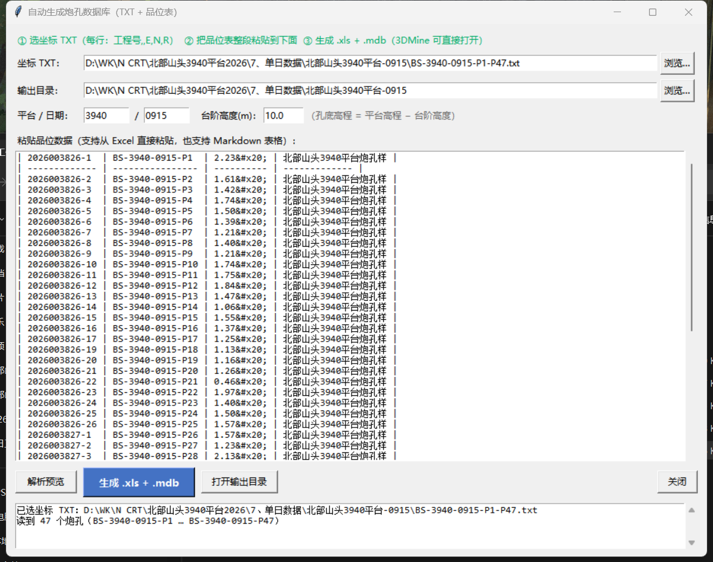

# 二次圈矿工具（3DMine 二次圈矿自动化）

**丢给它两个文件，一键出三件套**：

* 输入：① 某平台的**炮孔数据库 Excel**（定位表 + 测斜表 + Blast List 品位表，直孔）
  ② 该平台的**年度综合图 DWG**（只读扫描，用来贴历史矿块边界）
* 输出：① **炮孔数据报告**（xlsx + 图片版 png）② **二次圈矿矿块图**（DXF，可选转 **DWG 2010**）
  ③ **矿块边界线 .3ds**（每个矿块一条闭合字符串，带体号）

核心是**自动圈连矿块**：按走向中线分左右链 → 逐段法向外推 → 端部按"外推 / 1/2 工程间距"
闭合 → 与综合图能贴上的那段改成走历史矿块边界 → 界内按品位档 + Voronoi 算量分块定档。
口径逐条写在 **[口径确认记录.md](口径确认记录.md)**（那份是唯一依据，以用户拍板为准）。

## 现在什么状态（2026-10-21）

**最新版**：[Release v1.10](https://github.com/bit479/auto-second-mining/releases/tag/v1.10)
（发布说明 + 可直接下载的绿色包 `second-mining-tool-v1.10.zip`）。
重新发版的脚本：`python _probe\publish_release.py`（说明取自 `_probe\release_notes_v1_10.md`）。

17 个炮区**验收全绿**，跑 `python _probe\accept_all.py` 一条命令可复现：

| 平台 | 炮区 | 矿界 IoU | 体积差（自动/人工） | 块数 |
|---|---|---|---|---|
| 3940 | 0915 / 0922 / 1003 / 1004 / 1008 | 0.62 ~ 0.95 | −1.3% ~ +6.1%（基准 = 人工报告） | 全部与人工图一致（0915 ✓7、0922 ✓4、1003 3/2、1004 4/3、1008 ✓3） |
| 3960 | 0825/0830/0902/0904/0908/0914/0919/0922/0922-2/1007/1008/1009 | 0.53 ~ 0.93 | **−2.9% ~ +6.8%**（基准 = 人工图算） | 全部与人工图一致 |

七类自检（都进了 `accept_all.py`）：

1. **圈矿闸门**（`selftest.py`）两档：常规档（生产跑法）+ **严格档**（把综合图里"当日本身
   已经圈过的块"排掉，模拟新炮区的真实场景）；
2. **报告口径回归**（`report_check_all.py`）：版式 + 每块口径自洽（重量=体积×容重、
   金属量=重量×品位÷100）+ 与人工报告的合计对账；
3. **成果图实体自检**（`dxf_check.py`）：图名 / 炮孔十字（1 m、色 138）/ 引线（1.2 m、
   跟品位档色）/ 工程号（与数据库逐条一致）/ 品位字高 / 1 m 方格 / 网格小字 /
   矿块号（不重号、不压矿块与报告表、**引线从矿块主体中心出发**）/ 报告表（**矢量 TEXT + LINE**，
   不引用外部图片，手机 CAD 也能看；Excel 默认风格：细边框、全部居中、紧凑行高）；
4. **精确模式自检**：人工在 3DMine 里画好的几段 .3ds 拼成矿界，与人工 1008 图 IoU 0.962。
5. **Excel 工具自检**：报告汇总 / 单日并入 / 格式自适应 / 文件占用检测（v1.8）。
6. **数据库生成自检**：坐标 TXT + 粘贴品位表 → `.xls/.mdb`，0915 的 47 孔实跑 11/11。
7. **自动矿块形状自检**：同一矿块必须连通、顶点抽稀到 <100、矿孔不出界、体积偏差 ≤±5%（v1.10）。

**v1.10 自动圈矿改进**：同一个矿块被 Voronoi 细缝切成的几片，会按最短断口用
1.2~3.0 m 窄走廊连成一片；矿块轮廓再做 0.3 m 抽稀（面积变化 ≤2%、矿孔不能出界）。
3960-0922 从 3 片/454 顶点变成 **1 片/38 顶点**，3960-1007 从 2 片/215 顶点变成
**1 片/23 顶点**；体积仍保持 +0.2% / -0.5% 的人工偏差。

## 怎么用

### 图形界面（推荐）

双击 **`启动二次圈矿工具.bat`**。界面自上而下：输入（数据库 / 综合图 / 平台 / 日期 / 输出目录）
→ 参数区（改完点"存为该平台默认"或"存为该炮区"；有"精确模式轮廓文件"框可直接导入人工画的
矿界 .3ds）→ 主按钮（**一键出三件套**、批量、并入综合图副本、人工图标定、确认替换）
→ **自查按钮**（查看参数台账 / 跑一键验收 / 快检 / 打开验收报告）。

**支持拖拽**（v1.1 起，需 `pip install tkinterdnd2`）：把数据库 Excel / 综合图 DWG /
人工圈矿图 DWG / 轮廓 .3ds / 输出文件夹**从资源管理器直接拖进窗口**，按类型自动落到对应栏
（数据库还会自动识别平台日期、自动找综合图、自动填输出目录）。

**也可以让程序别自己圈矿**（v1.2 起）：在 3DMine 里自己圈好矿块、导出 .3ds，填进"轮廓文件"栏并
**勾上"人工圈矿模式"**——程序就按你画的线逐块算量、出报告和成果图（一条闭合线 = 一块）。

**没闭合的线也能用**（v1.5 起）：.3ds 里**闭合线当矿界、开口线当分块切线**
（切线两端沿各自方向外延切穿矿界，切出来的每一片 = 一块；切出来的小边角**不丢**，
并入相邻的最大块——v1.7 起，1004 左下角那块 5.85 m² 的青色小片就是按这条保留的）；
只有开口线时按"首尾相连"各成一块。所以 "N CR 1018未闭合线.3ds"（1 条闭合矿界 + 3 条开口切线）
能直接出 4 块，与闭合版（76.1 / 77.7 / 111.9 / 772.9 m²）基本一致（本工具 76.1 / 71.8 / 111.9 / 772.9）。

**交付里多了两样**（v1.5 起）：同内容的旧版 **`.xls` 报告**，以及 **`炮孔数据报告分表/`**
文件夹（每块一份 xlsx，3DMine 分表版式：标题/表头/该块/小计/总计）。

## 速度（v1.6 起）

DXF → DWG 2010 不再只走 AutoCAD COM，而是**自动挑最快的**：

| 顺序 | 转换器 | 特点 | 实测 |
|---|---|---|---|
| ① | **ODA File Converter**（装了才用） | 免费、**完全不依赖 AutoCAD** | ~1 秒 |
| ② | **accoreconsole**（AutoCAD 自带的无界面内核） | 不开 GUI、不走 COM、独立进程 | **约 2 秒** |
| ③ | AutoCAD COM（老路径） | 兜底 | 6~7 秒（AutoCAD 没开还要等启动 30~60 秒） |

综合图扫描也一样：COM 失败/没缓存时改用 **accoreconsole 把 DWG 转 DXF + ezdxf 读**（约 3~4 秒）。

想彻底不用 AutoCAD：装 ODA File Converter（Open Design Alliance 免费工具），装好后程序自动发现；
装在别处就设环境变量 `ODA_FILE_CONVERTER=<ODAFileConverter.exe 路径>`。
实测一条 1008 的完整流程：第 1 步（圈矿+报告+图+.3ds+.xls+分表）约 5.8 秒，
第 2 步（DXF→DWG2010，accoreconsole）约 2.0 秒。

## Excel 工具（v1.3 起已整合进来）

原来单独的 `Excel处理工具` 已经搬进本项目（`excel_tools\`），主界面下方多了一块
**"Excel 工具（报告汇总 / 单日数据并入总表）"**：

| 按钮 | 作用 |
|---|---|
| **炮孔报告汇总…** | 打开完整窗口：把若干份 3DMine 分块报告汇总成一份炮孔数据报告（`total`/`detail` 两种口径，默认 `total`＝每份文件的总计行当一个矿块） |
| **单日数据并入总表…** | 打开完整窗口：把某一天的 `xls / mdb / 报告` 并入 2026 年三份总表，**并顺手把二次圈矿矿块图复制进 `6、` 文件夹**（自动识别、按工程号判重、自动备份、可还原） |
| **把数据库所在的那天并入总表（预演）** | 用界面上选的数据库所在文件夹当日目录，**只算不写**，结果打到日志区 |
| **正式并入** | 同上但真写（先弹窗确认；写前把总表备份成 `bak/<原名>_并入<日>.bak`） |

> **v1.4 新增**：单日并入时一并复制二次圈矿矿块图
> （`7、单日数据\…\5、 …二次圈矿矿块图1011.dwg` → `6、…二次圈矿矿块图\…二次圈矿矿块图1011.dwg`，
> 去掉开头的「N、」前缀）。目标已有同名图且逐字节相同就跳过；内容不同则先备份 `bak/<原名>.bak` 再覆盖。

**`.bak` 统一收纳**（v1.7.2 起）：程序生成的备份一律写进同目录的 `bak\` 子文件夹；
运行一键出图 / 并入总表 / 并入综合图时，也会把所在文件夹里已有的 `.bak` 一并收进 `bak\`。
> 不想让它参与时命令行加 `--no-map`，或界面取消勾选。

命令行入口：`python excel_tools\main.py --help`（`--gui --tab report|daily` 开界面、
`--daily --day-dir … [--dry-run|--restore]` 并入/还原、`-i/-d/-p/-o` 报告汇总）。
它自己的五项自检也进了 `accept_all.py`（`跑验收.bat` 会一起跑）：
`python excel_tools\tests\test_by_total.py | test_merge.py | test_daily_merge.py | test_formats.py | test_locks.py`。

## 新建炮孔数据库（v1.9 起）

主界面「Excel 工具」下面新增 **"从坐标 TXT + 品位表生成 .xls/.mdb…"**：
把一个坐标 TXT（也可以直接把 `BS-…txt` 拖进主窗口）和一段品位表交给程序，
就能生成 3DMine 可直接打开的 `1、…xls` 和 `2、…mdb`。



步骤：

1. 选坐标 TXT：每行 `工程号,,开孔坐标E,开孔坐标N,开孔坐标R`；
2. 平台/日期自动从 `BS-3940-0915` 识别；输出目录默认 TXT 所在文件夹；
3. 把品位表整段粘到下面——支持从 Excel 直接粘贴，也支持 Markdown 表格；
4. 点 **解析预览**：会报"缺哪些工程号 / 多出哪些 / 同号品位冲突"；
5. 点 **生成 .xls + .mdb**。

默认台阶高度 **10 m**：孔底高程 = 平台高程 − 10，最大孔深 = 开孔坐标R − 孔底高程。
`.xls` 写精确孔深，`.mdb` 按 3DMine 现有库的习惯取整到整米；`.mdb` 用
`assets\3dmine_template.mdb` 空库模板生成，保留 `config_table_3dmine` /
`style_table_3dmine` / `constraint_table_3dmine` 元数据。

目标 `.xls/.mdb` 已存在时，界面会确认；确认后先备份到同目录 `bak\` 再覆盖。

### 双击就能用的另外两个 .bat

| 双击 | 作用 |
|---|---|
| **`跑验收.bat`** | 跑全套验收（约 3 分钟），完了自动打开 `验收报告.md`；想快检就 `跑验收.bat --quick` |
| **`看参数台账.bat`** | 打开参数台账（哪个炮区覆盖了什么、依据是什么） |
| **`首次运行检查.bat`** | 环境自检（Python/依赖/数据目录/参数/输出目录/AutoCAD），换机器先跑它 |

交付/交接那一份说明在 **[交付说明.md](交付说明.md)**（怎么开始用、需要什么环境、安全边界）。
桌面上有一个 **`二次圈矿工具`** 快捷方式，指向 `启动二次圈矿工具.bat`。

### 命令行

```
python core\run_strip.py "<数据库.xls>" 3940 <日期> "<输出目录>" "<综合图.dwg>"   # 一个炮区
python core\run_batch.py "<父目录>" "<综合图.dwg>" "<输出目录>"                    # 整个目录
python _probe\accept_all.py                                                      # 一键验收（约 3 分钟）
python _probe\params_report.py [平台]                                            # 参数台账
```

## 文档地图

| 文件 | 内容 |
|---|---|
| **[口径确认记录.md](口径确认记录.md)** | **所有已确认口径**（算量、矿界、分块、图上要素、参数与依据），有冲突以最新一条为准 |
| [项目结构说明.md](项目结构说明.md) | 目录/模块清单、参数三层结构、加新平台的步骤、改代码的规矩 |
| [使用说明-一键出三件套.md](使用说明-一键出三件套.md) | 操作手册：输入、产出、参数、故障提示、验收与台账 |
| [故障与排查.md](故障与排查.md) | 出问题按症状查：输入类 / 圈矿结果 / 出图要素 / 综合图 / 验收，每条给"先看哪儿、怎么办" |
| [验收报告.md](验收报告.md) | 最近一次一键验收的自动报告（带代码版本、逐项结论、完整日志） |
| `归档\` | 旧版说明与一次性调试产物 |

## 铁律（改这个项目必须先知道）

1. **口径以用户拍板为准**，不确定就问，不要自己拍阈值；所有阈值都用人工图标定或用户确认。
2. **真实矿山数据只读**：`北部山头3940平台2026\`、`北部山头3960平台2026\` 不挪不改；
   综合图只用 AutoCAD **只读**扫描；"并入综合图"一律先出**副本**，替换原件要人工确认。
3. **改完代码跑 `python _probe\accept_all.py`**，全绿再提交；退化就退回来。
4. **不要动 3DMine 安装目录**（曾因改动导致 3DMine 打不开）。
